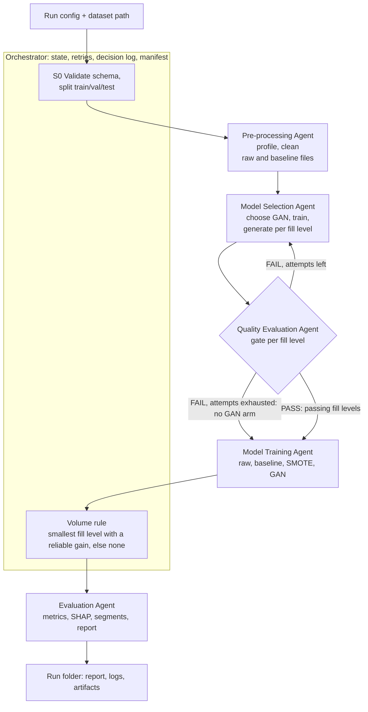
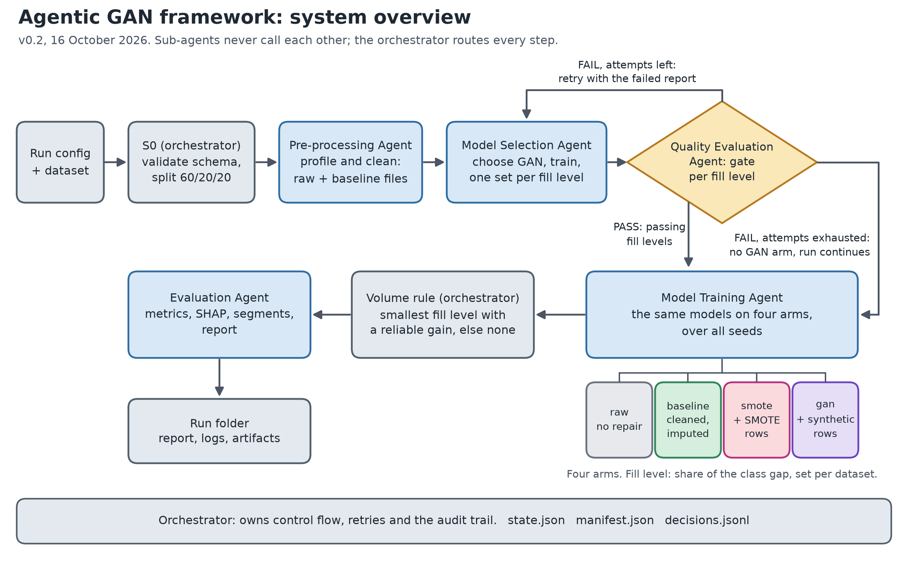
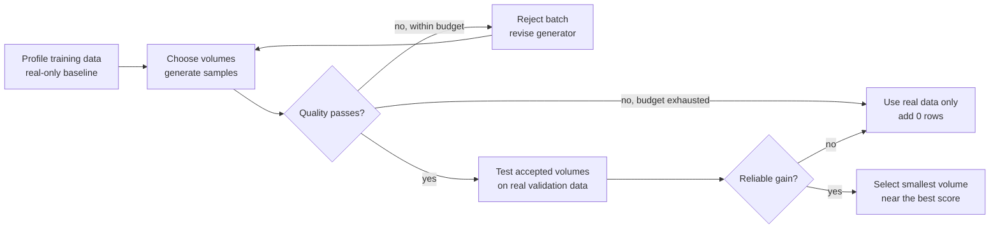
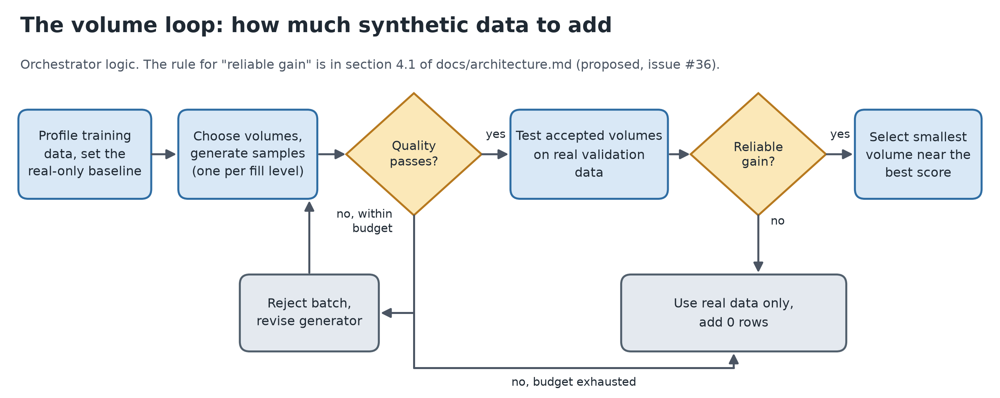

# Agentic GAN Framework: System Architecture

Team 23, Columbia Data Science Capstone with TD Bank. Draft v0.2 for the mentor meeting on 16 October 2026. Tracks GitHub issues #4 and #23.

v0.2 adds the mentor feedback of 9 October and matches the code merged so far. The main changes from v0.1:

- Four comparison arms (`raw`, `baseline`, `smote`, `gan`) instead of three (section 1).
- Synthetic volume is a fill level, a share of the class gap, chosen by a volume loop (section 4.1).
- Every agent has a table of the questions it answers and what it returns.
- The typed handoffs in section 7 are the real classes in `src/agentic_gan/schemas.py`.
- A dataset table, the framework decision and the Credit Card Fraud findings.

Paragraphs headed **Implementer notes** list what to keep in mind when building each part.

## 1. Purpose and scope

This document defines the agents in the system, what each one is responsible for, what it takes in and puts out, and how the orchestrator moves a run from raw data to a final report. It is the blueprint the team builds from. The framework is LangGraph (section 11). The document does not contain implementation code.

The system answers one question: does GAN-generated data improve a downstream model, and can an automated pipeline decide that reliably and document the decision? To answer it, every run compares four data pipelines, called arms, on the same held-out real test set. Arms are named rather than lettered, because in v0.1 the letters meant different things.

| Arm | Training data | What the comparison tells us |
|---|---|---|
| `raw` | Real training split, encoded and scaled like `baseline` but with no repair: missing values stay missing, no placeholder or sentinel handling, no deduplication | Starting point, and the no-repair control |
| `baseline` | Real training split after the Pre-processing Agent: cleaned, imputed, encoded and scaled, every step fitted on the training split only | `baseline` vs `raw` is the value of data repair. It is also the reference that `smote` and `gan` must beat |
| `smote` | `baseline` training split plus SMOTE rows (SMOTENC for mixed types) at a fill level | Value of a simple oversampler |
| `gan` | `baseline` training split plus accepted synthetic records at a fill level | `gan` vs `baseline` is the value of synthetic data. `gan` vs `smote` is whether a GAN beats a simple oversampler |

**Why a raw arm.** Data repair is part of the project, and without a no-repair control nothing can be credited to the Pre-processing Agent. `smote` and `gan` are built on `baseline`, so any lift from augmentation is not repair in disguise. The gap between `raw` and `baseline` should be visible where there is something to repair (Polish Bankruptcy, and the placeholders and sentinel in Bank Marketing) and small where there is not (Default of Credit Card and Credit Card Fraud have no missing values).

**Fill level.** The amount of augmentation is a fill level: the share of the training class gap that is filled with extra positive rows. The class gap is the number of negatives minus the number of positives in the training split, so a fill level of 1.0 balances the classes. The default grid is 0.10, 0.25, 0.50, 0.75 and 1.00. It is set per dataset in the config because class gaps differ widely (about 20,800 rows at 1.0 for Bank Marketing, about 170,000 for Credit Card Fraud). A fill level of 0 is `baseline` itself. `smote` uses the same grid as `gan`, so the two add the same number of rows at each level. The rule is `fill_rows` in `schemas.py`: `round(fill_level * (negatives - positives))`.

**Files and encoding.** The arms are pipelines. The files the Pre-processing Agent writes hold the cleaned tables before encoding, because the GAN reads categorical columns as they are. The fitted transformer encodes and scales those tables for the models, and for synthetic rows, using treatments fitted on the real training rows only.

### Datasets

The four datasets in scope. Numbers come from the EDA and the 9 October slides, and were checked against the data where it is available locally.

| Dataset | Rows | Positives | Train positives | Rows added at fill 1.0 | Missing values | Exact duplicate rows |
|---|---|---|---|---|---|---|
| Default of Credit Card Clients (UCI 350) | 30,000 | 6,636 (22.1%) | 3,982 | 10,036 | none | 35 |
| Bank Marketing (UCI 222) | 45,211 | 5,289 (11.7%) | 3,173 | 20,780 | 52,124 cells (`unknown` in four columns), plus the `pdays = -1` sentinel | 0 |
| Polish Bankruptcy (UCI 365) | 43,405 | 2,091 (4.8%) | 1,255 | 23,533 | 1.5% of cells, 54% of rows have a gap, worst column A37 (43.7%) | 401 |
| Credit Card Fraud (ULB) | 284,807 | 492 (0.17%) | 295 (284 after dropping duplicates) | 170,294 (169,667 after) | none | 1,081 |

- All four use a stratified 60/20/20 split with seed 42. For Credit Card Fraud the recommendation is to drop exact duplicate rows first (`docs/fraud_dataset_recommendation.md`).
- Bank Marketing is the primary dataset. Default of Credit Card is the cleanest place to test generated data, since it has no missing values. Polish Bankruptcy tests the data-repair step. Credit Card Fraud has too few positives to expect a gain and is the stress case.
- Polish Bankruptcy pools five forecasting-horizon cohorts and has no company identifier. Its missingness is informative: column A27 is missing in 34.5% of bankrupt training rows and 4.9% of the others.
- Default of Credit Card stores six monthly payment columns per client, which makes it the TimeGAN candidate (section 12, question 4).

## 2. Design principles

1. **Deterministic where it matters, LLM where it helps.** Anything that decides the outcome of the experiment (splits, which GAN to use, whether synthetic data is accepted, which model wins) is a coded rule with logged inputs. The LLM is used for bounded tasks only (section 6).
2. **Real data is the only evaluation data.** The train, validation and test split is made once, before any cleaning or GAN training. Synthetic records are added to the training set only. Validation and test sets never contain synthetic rows.
3. **The GAN never sees the test set.** The generator is trained on the training split only, so a gain in the `gan` arm cannot come from leakage.
4. **Typed handoffs.** Each agent receives and returns a schema-validated object (Pydantic, in `src/agentic_gan/schemas.py`) pointing to artifacts on disk. The orchestrator rejects an output that fails validation.
5. **Everything is logged.** Each decision is written with its inputs, the rule applied, and the outcome.
6. **Failures are results.** If synthetic data fails the quality gate, the run records that and continues without augmentation. A weak or negative result is reported, as the mentors asked.
7. **Synthetic data is always labelled.** Every synthetic file carries an `is_synthetic` column and a metadata header. It is never merged with real data without that flag.

## 3. System overview





The orchestrator owns control flow and state. Sub-agents do not call each other. They return results to the orchestrator, which decides the next step. This keeps retries, logging and failure handling in one place. The picture above is a static copy of the diagram for slides.

### Shared state

Each run writes to `runs/<run_id>/`:

```
runs/<run_id>/
  config.yaml              resolved config (RunConfig), saved when the run is created
  state.json               RunState: status and attempts per stage, GAN availability, volume decision
  manifest.json            header (run id, start time, dataset and config hashes, package versions)
                           and an index of every artifact with path, hash, producing stage
  decisions.jsonl          one line per decision: agent, rule, inputs, outcome, rationale
  data/                    split files, raw and baseline files, synthetic files (is_synthetic=1)
  profile/                 profile.json, plots
  synthetic/               generator checkpoint, attempt history
  quality/                 quality_report.json, plots
  models/                  fitted models, per-arm metrics
  explain/                 SHAP outputs, segment tables
  report/                  final_report.md, tables
```

A run can be reproduced from `config.yaml` and the raw file. The manifest header holds the hash of each, and the package versions that `config.yaml` does not cover.

The code is in `src/agentic_gan/orchestrator/`: `create_run` makes the folder, `RunState` (`state.py`) is `state.json`, and `Manifest` (`manifest.py`) is `manifest.json`. The default run id is the dataset name plus the UTC start time. An existing run folder is never reused or overwritten.

**Implementer notes.**

- Write every file an agent produces inside the run folder. A path outside it, or a path to a file that does not exist, is refused when the output is registered in the manifest.
- Put files in the subfolder that matches their kind (`data/`, `profile/`, `synthetic/`, `quality/`, `models/`, `explain/`, `report/`). The manifest does not enforce this, but later agents and the report look there.
- A file belongs to one stage. Registering the same file again after a retry by the same stage is fine and replaces its hash. Registering it under a different stage is an error.
- `Manifest.verify()` also checks `config.yaml`, so nothing may edit it after the run starts.

## 4. Orchestrator Agent (issue #5)

**Purpose.** Run the pipeline end to end, enforce the rules in section 2, and keep the audit trail.

**Questions this agent answers.**

| Question | How it is decided | Returned as |
|---|---|---|
| Can this dataset be used as configured? | `validate_schema`: columns, target, positive class, class sizes | `SchemaError`, or the validated data |
| Which rows go in train, validation and test? | `split_data`: two stratified steps with a fixed seed | `SplitOutput` |
| Is each agent's output valid? | Check against the output type in `STAGE_IO`. Listed files must exist inside the run folder | Registered artifacts, or a stage error |
| Do we retry or stop? | `max_stage_retries` for errors, `max_attempts` for the quality gate | `RunState` (`RETRY`, `FAILED`) and a decision-log line |
| Does the GAN arm run? | The quality verdict after the last attempt | `gan_available`, with a reason when false |
| How much synthetic data do we add? | The volume loop (section 4.1) | `volume_decision` |
| Did the run finish cleanly? | A complete `RunState` and a clean `Manifest.verify()` | `state.json`, `manifest.json`, or a partial report |

**Inputs.** `RunConfig`: dataset path and name, target column, positive class (quoted in YAML, because an unquoted `yes` is read as a boolean and rejected), split ratios and seed, model seeds, excluded features, the fill-level grid, quality-gate thresholds, sanity rules, `max_attempts` (quality-gate attempts), `max_stage_retries`, GAN search bounds, candidate models, `min_rows` and whether to calibrate.

**Responsibilities.**

1. Validate the config (building a `RunConfig` does this) and the dataset with `validate_schema`: no duplicate or empty columns, a target that is present, has no gaps and has exactly two values, a positive class that occurs, excluded features that exist, and at least 3 rows of each class.
2. Create the stratified train/validation/test split with `split_data` (default 60/20/20, stratified on the target, fixed seed) and write `train.csv`, `val.csv` and `test.csv` to `data/`. The split is two stratified steps: first hold out validation plus test, then divide the hold-out. The EDA row-ID files and Raghav's baseline script use the same recipe, so all of them put the same rows in each part. This is a tool call, not an LLM step.
3. Call each sub-agent in order, validate its output object, and write a decision-log entry.
4. Apply the gate logic: on a `FAIL` verdict, re-invoke the Model Selection Agent with adjusted settings, up to `max_attempts` (default 3). After that, set `gan_available = false` with a reason and continue. Training still runs the `raw`, `baseline` and `smote` arms.
5. Handle failures: agent timeout, schema-validation error or exception gives `max_stage_retries` retries (default 1), then marks the stage `FAILED` and stops the run with a partial report.
6. Assemble the manifest and hand the final state to the Evaluation Agent.

**Outputs.** `manifest.json`, `decisions.jsonl`, and the final `RunState` (`state.json`): status and attempts per stage, `gan_available` with its reason when false, and `volume_decision` (the fill level chosen by the volume rule, where 0.0 means real data only). The volume rule is issue #36. Until it exists, `volume_decision` stays unset.

**Tools.** `validate_config` (building a `RunConfig` validates it), `validate_schema` and `split_data` (`orchestrator/split.py`), `write_manifest` (`Manifest.register` and `Manifest.save`), `log_decision`, plus the sub-agents themselves.

**Decision logic.** Fully deterministic: stage order, retry counts, gate routing. No LLM call decides control flow.

**Success.** All stages `SUCCESS` or `SKIPPED` with a reason, and `Manifest.verify()` returns no problems: every referenced artifact exists and its hash matches.

**Implementer notes.**

- The first stage is `split_data(config, run)`, which returns a `SplitOutput`. It reads `config.dataset_path`, which must be a comma-separated CSV with a header that includes the target column. Other source formats are converted to that CSV by the dataset loaders (issue #29).
- A dataset that fails `validate_schema` raises `SchemaError` before anything is written. That cannot change on a retry, so go straight to `FAILED` and use the message as the reason.
- `split_data` adds a warning to `SplitOutput` for any part with fewer than 100 positives. Carry warnings into the report.
- `split_row_ids(config, df)` returns the row labels of each part without writing any data. Use it to produce the shared row-ID files in `splits/` from the same code the orchestrator uses.
- Check every agent output at the handoff with the output type in `STAGE_IO` (`schemas.py`), for example `STAGE_IO[Stage.PREPROCESSING][1].model_validate(raw)`. A failure counts as a stage error.
- `RunState` is immutable. Each change returns a new state (`state.start(stage)`, `state.finish(stage, status, reason)`, `state.skip(stage, reason)`), so keep the latest one and save it to `state.json` after every change. A crash then leaves a usable partial run.
- The state enforces stage order: a stage cannot start until every earlier stage is `SUCCESS` or `SKIPPED`. If Model Selection is skipped, skip the quality check too, with a reason.
- `StageState.attempts` counts every invocation, including error retries and quality-gate re-runs. The gate attempt number sent to Model Selection (`ModelSelectionInput.attempt`, from 1) is a separate count.
- Record `RETRY` (with a reason) in the state when you decide to repeat a stage after an error. Agents return `SUCCESS`, `FAILED` or `SKIPPED`.
- Register an output in the manifest right after it passes validation, under the stage that produced it, and save the manifest.
- In the graph, keep `RunState` as one key of the graph state and have each node return a new `RunState` (LangGraph, issue #25).

### 4.1 The volume loop: how much synthetic data to add

The benefit of augmentation varies across datasets, so the amount is decided per dataset, from evidence, and adding nothing is always a candidate. The loop is the orchestrator's logic. It comes from the 9 October discussion with the mentors.

**What guides the decision.**

| Input | How it guides the decision | Where it comes from |
|---|---|---|
| Class imbalance | Use the class counts to test partial and full balancing, and include zero synthetic rows as a candidate | `baseline_train_positives`, `baseline_train_negatives`, and the fill-level grid in the config |
| Preprocessing findings | Missingness, rare groups and class overlap show how hard the data is to generate and how much repair matters | `profile.json` |
| Validation feedback | Quality checks, including the discriminator check, flag poor synthetic data. Real validation performance selects the volume | `QualityReport`, and the validation predictions in `TrainingOutput` |

**The loop.**





1. Profile the training data and set the real-only baseline (Pre-processing Agent). The `baseline` arm is fill level 0.
2. Choose the volumes and generate. The volumes are the fill levels in the config, set per dataset (default 0.10, 0.25, 0.50, 0.75 and 1.00). The Model Selection Agent generates one set per level.
3. Quality check each set. A level that passes goes on. If no level passes, reject the batch, revise the generator and retry within the budget (`max_attempts`). If the budget is exhausted, use real data only and add 0 rows.
4. Test the accepted volumes on real validation data. The Training Agent fits `gan`, and `smote` as the comparison, at every accepted level and for every seed.
5. Ask whether the gain is reliable. If it is, select the smallest volume near the best score. If not, use real data only and add 0 rows.
6. Record the choice as `volume_decision`, with the reason, and write it to the decision log.

**The rule for step 5 (proposed, to be finalised in issue #36).**

- Compare on validation PR-AUC, the selection metric the baseline runs use. Test data is not used.
- The gain of a level is its mean validation PR-AUC over seeds minus that of `baseline`.
- A gain is reliable if it is larger than the seed-to-seed spread (one standard deviation of `baseline` over seeds) and positive for most seeds.
- Choose the smallest level whose mean is within one spread of the best reliable level. If no level is reliable, `volume_decision` is 0.0 with the reason "no reliable gain".
- The seed spread measures training randomness, not the noise from a small validation set. For datasets with few validation positives (Credit Card Fraud has about 94 after dropping duplicates), also bootstrap the validation rows and require the gain to hold there.

**Where it runs.** The orchestrator calls `choose_volume` (`tools/volume.py`, issue #36, if time permits) after training and before evaluation. Until that tool exists, `volume_decision` stays unset and the report says the volume rule did not run. Training evaluates every accepted level in one pass instead of adding volume step by step. That costs more compute but is simpler and reproducible, which is why the Credit Card Fraud grid is reduced (`docs/fraud_dataset_recommendation.md`).

## 5. Sub-agents

### 5.1 Pre-processing Agent (issue #6)

**Purpose.** Produce a profiled, cleaned version of the real data and document every treatment.

**Questions this agent answers.**

| Question | How it is decided | Returned as |
|---|---|---|
| How much is missing, and where? | Profile: missing share per column, and sentinel values such as `unknown` and `-1` | `profile.json` |
| Is a placeholder informative? | Compare the target rate of rows with the placeholder against the rest, and the share of rows affected (rule table below) | A treatment-log row per column |
| Which fix does each column get, and why? | The treatment rule table | The treatment log and the `baseline` files |
| Do duplicates, rare groups or class overlap threaten the data? | Profile: exact duplicates (the whole raw row), rare categories, class overlap | `profile.json` and warnings |
| How imbalanced is the training split? | Class counts of the `baseline` training file | `baseline_train_positives`, `baseline_train_negatives` |
| Was everything fitted on training rows only? | The number of rows used to fit the transformer | `transformer_fit_rows` |

**Inputs.** `PreprocessInput`: the `SplitOutput` (train, validation and test files from S0) and the config. The profile and the fitted treatments come from the training split only. Validation and test are transformed with the training-fitted treatments.

**Responsibilities.**

1. Profile: types, cardinality, missing and sentinel values (such as `unknown`, `-1`), duplicates, class balance, numeric distributions and outliers, correlations. Write `profile.json` and plots.
2. Missingness analysis: classify each affected column by how much is missing and what the placeholder means.
3. Clean: apply treatments by rule (below). Fit on train, apply to all three splits.
4. Write the data-treatment log: one row per column with the issue found, the treatment, and the reason.

**Treatment rules (proposed, to be tuned after EDA).**

| Condition | Treatment |
|---|---|
| Placeholder is informative (e.g. `poutcome = unknown`, about 82% of rows, mostly no prior campaign) | Keep as its own category. Do not impute. |
| Placeholder is a true gap, under 5% of rows | Mode (categorical) or median (numeric) imputation |
| Placeholder is a true gap, 5% or more | Model-based imputation (for example iterative or kNN), plus a missing-indicator flag |
| Sentinel numeric value (e.g. `pdays = -1`) | Replace with NaN plus a separate indicator column |
| Exact duplicate rows | Report, and drop only inside the training split |
| Outliers | Flag, do not remove by default. Winsorise only if a rule in the config says so |
| Leakage-prone feature (`duration`, known only after the call) | Excluded from the model feature set by config, and documented |

**Outputs.** `PreprocessOutput`: two file sets, `raw` (encoded and scaled, no repair) and `baseline` (cleaned), each with train, validation and test paths; `profile.json`; plots; the treatment log; the fitted transformer with the number of rows it was fitted on; and the number of positives and negatives in the `baseline` training file.

**Tools.** `profile_dataframe`, `detect_placeholders`, `impute`, `encode`, `plot_distributions`, `write_treatment_log`.

**Decision logic.** Rule table above. The LLM may write the plain-language summary of the profile. It does not choose treatments.

**Success.** No unresolved NaN in the `baseline` files (the `raw` files keep missing values by design), every column has a treatment-log row, and train-only fitting is confirmed by the fitted transformer's recorded row count.

**Implementer notes.**

- `raw` and `baseline` must be encoded and scaled in the same way, so that the only difference between them is repair. Do not give one arm a different encoder, scaler or feature set. Both drop the config's excluded features (for example `duration`).
- `raw` keeps missing values as NaN, keeps placeholders and sentinels as in the source (`pdays = -1` stays a number) and keeps duplicate rows. The scaler and encoder for `raw` must therefore tolerate NaN.
- Fit every transformer on the training split only, for each arm separately. Record the number of training rows used in `transformer_fit_rows`. It must equal the number of rows in that arm's training file.
- Count the positives and negatives in the `baseline` training file after any duplicate rows were dropped, and return them as `baseline_train_positives` and `baseline_train_negatives`. Fill levels are computed from these counts, not from the counts in `SplitOutput`, which describe the split before cleaning.
- Return `SUCCESS` only when every required field is present. Otherwise return `FAILED` with a reason.
- The shared preprocessing script (`tools/preprocessing.py`, settings in `utils/datasets.json`, notes in `docs/preprocessing.md`) already writes cleaned, unencoded `train`, `validation` and `test` tables to `data/interim/<dataset>/`. The agent calls its functions as tools. The tables carry a `source_row` column, which models and the GAN must not use as a feature.
- That script recreates the split from the dataset settings instead of reading the `SplitOutput` files. Both use the same two-step stratified recipe today. Keep the recipe identical until there is a single implementation.
- Encoding and scaling are fitted inside each cross-validation fold by the training tools (`docs/notes/baselines.md`). `transformer_path` should hold the `baseline` transformer that is reused on synthetic rows. A separate transformer for the `raw` arm is not in the schema yet.
- Polish Bankruptcy is where repair should matter, because its missingness is informative (section 1). Of the treatment rules, the missing-indicator flag is the first to try there. A column that is 5% or more missing gets it under the rule table, and A27 is 6.4% missing.
- Exact duplicates are whole raw rows, `Time` included for Credit Card Fraud. Deduplicating after a column has been dropped would delete legitimate repeated transactions. If duplicates are dropped before the split, that happens in the split step (`docs/fraud_dataset_recommendation.md`).

### 5.2 Model Selection Agent (issue #7)

**Purpose.** Choose the right generator for the data, train it, and produce synthetic records.

**Questions this agent answers.**

| Question | How it is decided | Returned as |
|---|---|---|
| Which generator fits this data, and why? | The selection rules below: column-type mix, row count, entity and time structure | `generator` and `rationale` |
| Is there enough data to generate at all? | `min_rows` and the structure checks | `SKIPPED` with a reason |
| How many rows at each fill level? | `fill_rows(level, positives, negatives)` | One `SyntheticSet` per fill level |
| Which settings on a retry? | The failing checks in `previous_report`, inside `gan_bounds` | `hyperparameters` |
| Did training behave? | The loss history: finite and not collapsed | `loss_history_path`. A collapse counts as a failed attempt |

**Inputs.** `ModelSelectionInput`: the config, the `PreprocessOutput` (the `baseline` training split and `profile.json` are the data to use), the quality-gate attempt number (from 1) and, on a retry, the `QualityReport` that failed.

**Responsibilities.**

1. Extract data characteristics: column-type mix, row count, class imbalance, and whether a defensible temporal structure exists (an entity identifier and a time index with at least `min_steps` observations per entity).
2. Select the generator by rule (below) and write the rationale to the decision log.
3. Train the generator on the training split only, using conditional sampling on the target so minority-class records can be requested directly.
4. Generate synthetic records for each fill level in the config grid (section 1), set `is_synthetic = 1`, and store the generator checkpoint. The number of rows at a level is `fill_rows(level, positives, negatives)`, using the `baseline` class counts in the `PreprocessOutput`.
5. On a retry, adjust training settings inside the allowed bounds using the previous quality report (more epochs, different batch size or `pac`, different discriminator steps).

**Selection rules (proposed).**

| Data characteristics | Generator |
|---|---|
| Mixed continuous and categorical columns, no entity/time structure | CTGAN (default) |
| Entity ID plus time index, enough steps per entity | TimeGAN |
| Mostly numeric, smooth distributions, CTGAN fails the gate twice | WGAN-GP or TableGAN as a documented fallback |
| Fewer than `min_rows` (config, start at 2,000) | No GAN. Report that the dataset is too small |

For the primary dataset, the rules choose CTGAN. `bank-full` has no customer identifier, so no per-customer sequences exist and TimeGAN is not selected. `bank-additional-full` is date-ordered but still has no entity key. Building campaign-level sequences from it would be a modelling assumption we would have to defend, so TimeGAN stays an optional extension tied to a second dataset (issue #3).

**Outputs.** `GeneratorOutput`: chosen generator, rationale, hyperparameters, checkpoint path, training-loss history path, and one `SyntheticSet` (fill level, row count, file path) per fill level.

**Tools.** `describe_data_characteristics`, `train_ctgan`, `train_timegan`, `train_fallback_gan`, `sample_synthetic`.

**Decision logic.** Selection is rule-based. On a retry, the LLM may propose new hyperparameters, but only values inside bounds fixed in the config, and the proposal is logged. Training itself is a tool call.

**Success.** Training completes, the checkpoint loads, and synthetic files match the real schema (columns, types, category sets).

**Implementer notes.**

- Return `SKIPPED` with a reason, not `FAILED`, when no GAN is appropriate (for example fewer than `min_rows` rows). The orchestrator then skips the quality check, sets `gan_available = false` and still runs the other arms. Return `FAILED` only when the agent itself breaks.
- Use only the `baseline` training split. Never read validation or test data when training or sampling.
- Compute the class gap from `baseline_train_positives` and `baseline_train_negatives` in the `PreprocessOutput`, not from the counts in `SplitOutput`, which describe the split before cleaning. `SyntheticSet.rows` is the number of rows you actually wrote. The quality check compares it with `fill_rows(...)` for that level, so it is not forced to match.
- Return one `SyntheticSet` per fill level. Two sets at one level are rejected.
- On a retry, `previous_report` is a `FAIL` report. Read its failing checks and keep new hyperparameters inside the config's `gan_bounds`. The schema rejects a retry without a report, a first attempt with one, and an attempt above `max_attempts`.
- Log the selection rationale, and any hyperparameter proposal, with `log_decision`.
- The CTGAN tool (issue #32) takes the cleaned, unencoded training table and cannot handle missing numeric values. The `baseline` files have none. Its row counts at each fill level should match `fill_rows`: for Bank Marketing, 2,078, 5,195 and 10,390 rows at 0.10, 0.25 and 0.50. Use `fill_rows` rather than a second copy of the formula.

### 5.3 Synthetic Data Quality Evaluation Agent (issue #8)

**Purpose.** Decide whether the synthetic data is good enough to train on, and say why. This agent is the gate.

**Questions this agent answers.**

| Question | How it is decided | Returned as |
|---|---|---|
| Is the synthetic data realistic? | Fidelity checks against the real training split | A `CheckResult` per check |
| Is it diverse, or has the generator collapsed? | Diversity check (reported only for now) | A `CheckResult` with `hard = false` |
| Is it novel and not copied? | Distance to closest record and the exact-duplicate count | A `CheckResult` |
| Is it valid? | The sanity rules in the config | A `CheckResult` |
| Is it useful? | TSTR against TRTR on real validation data | A `CheckResult` |
| Can a classifier tell it from real data? | Discriminator feedback (reported only for now) | A `CheckResult` with `hard = false` |
| Does it match the requested volume? | Achieved fill level against requested | A `CheckResult` |
| Pass or fail, and which fill levels pass? | The hard checks at each level | `verdict`, `levels`, `passing_levels` |

**Inputs.** `QualityInput`: the config (thresholds in `quality_gate`, and the sanity rules), the `PreprocessOutput` (the real `baseline` training and validation files) and the `GeneratorOutput` (the synthetic files).

**Checks.**

| Dimension | Metrics | Compared against |
|---|---|---|
| Fidelity, univariate | KS (numeric), Wasserstein (numeric), JS divergence (categorical) per column | Real training split |
| Fidelity, joint | Pairwise correlation difference (Pearson and Cramér's V), mean absolute difference of the correlation matrices | Real training split |
| Utility | TSTR (train on synthetic, test on real) and TRTR (train on real, test on real), using the same classifier. Report the AUC and PR-AUC gap | Real validation split |
| Privacy | Distance to closest record (synthetic to real training) against the same distance for real validation rows. Exact-duplicate count. | Real validation split |
| Sanity | Category sets, value ranges, impossible combinations (rule list in config, e.g. `age >= 18`) | Schema |
| Diversity | Coverage of the real categories and value ranges, spread of pairwise distances, near-constant output | Real training split |
| Discriminator feedback | How well a classifier separates real from synthetic rows. Near chance is good | Real training split |
| Label balance | Achieved fill level against the requested fill level | Request |

**Gate logic (starting values, to be calibrated on the real data in EDA).**

- Mean per-column KS and JS below 0.10, with no single column above 0.25.
- Correlation-matrix mean absolute difference below 0.10.
- TSTR AUC within 0.05 of TRTR AUC.
- Median distance-to-closest-record for synthetic rows not smaller than for real validation rows, and zero exact duplicates of training rows.
- Zero sanity violations after the config rule list.
- Diversity and discriminator feedback are reported but do not gate (`hard = false`) until their thresholds are calibrated (issue #12). They still inform the retry. The 9 October discussion lists validity, diversity, duplication and discriminator feedback as the quality checks.

The checks run on each synthetic set, that is, at each fill level. A level passes when all of its hard checks pass. The verdict is `PASS` if at least one level passes and `FAIL` if none does. On `FAIL`, the orchestrator retries the Model Selection Agent, which receives this report with its failing metrics.

**Outputs.** `QualityReport`: the overall `verdict` (`PASS` or `FAIL`); one `LevelReport` per fill level, holding its checks (name, value, threshold, passed, hard) and whether the level passed; the path to `quality_report.json`; and plots (per-column real vs synthetic distributions, correlation heatmaps). `passing_levels` lists the levels that passed.

**Tools.** `ks_test`, `js_divergence`, `wasserstein`, `correlation_diff`, `tstr_trtr`, `dcr_privacy`, `sanity_rules`, `diversity_checks`, `discriminator_check`, `plot_comparison`.

**Decision logic.** Deterministic. The verdict is computed from the thresholds. The LLM only writes the prose summary of the report and never changes the verdict.

**Success.** All metrics computed with no NaN, and a verdict recorded with the thresholds that produced it.

**Implementer notes.**

- A `FAIL` verdict is a normal result. Return status `SUCCESS` with `verdict = FAIL`. Return status `FAILED` only when the agent itself breaks (a crash, or metrics that cannot be computed).
- The schema rejects an inconsistent report. A level's `passed` must equal "all its hard checks passed", and the verdict must be `PASS` exactly when some level passed. Compute both from the thresholds. Never set them by hand.
- Metric values must be finite. NaN and infinity are rejected, which matches the success rule above.
- Set `hard = false` on a check that is only informative. It is reported but cannot fail a level.
- Report each fill level in the generator output once, and no level twice.
- For the label-balance check, take the requested rows from `fill_rows(level, ...)` with the `baseline` class counts in the `PreprocessOutput`, and compare them with `SyntheticSet.rows`.
- Put the path of `quality_report.json` in `report_path` and the plots in `plot_paths`, so the manifest records them.

### 5.4 Model Training Agent (issue #9)

**Purpose.** Train the same set of models on each arm under identical conditions.

**Questions this agent answers.**

| Question | How it is decided | Returned as |
|---|---|---|
| Which model is best on each arm and fill level? | Tuned with an identical budget and selected on real validation data only | A `ModelRecord` with its hyperparameters |
| What does each model predict on validation and test? | Predictions saved for every arm, fill level, model and seed | The prediction paths |
| Can this model run on this arm? | Whether it accepts the arm's data (for example NaN on `raw`) | A `SKIPPED` record with a reason |
| Is the evaluation data clean? | No synthetic or resampled row in validation or test | The success check |
| How noisy are the results? | Every run repeated over the config's seeds | One record per seed |

**Inputs.** `TrainingRequest`: the config, the `raw` and `baseline` file sets, and the accepted synthetic sets (the fill levels that passed the gate). No accepted sets means the `gan` arm is not run.

**Responsibilities.**

1. Build the training set for each arm: `raw`; `baseline`; `smote` (the `baseline` training split plus SMOTENC rows at each fill level in the config grid, resampled inside this agent); and `gan` (the `baseline` training split plus the accepted synthetic set at each accepted fill level).
2. For each arm, train logistic regression, random forest, gradient boosting, XGBoost and LightGBM. Neural nets are optional.
3. Tune with the same search budget per arm, selecting on the real validation split only.
4. Repeat for each seed in the config (default 5) so results carry a spread.
5. Fit probability calibration on validation if the config requests it.
6. Save models and predictions on validation and test.

**Raw arm and missing values (current choice, open for discussion).** `raw` keeps missing values, and some models reject NaN. Checked with scikit-learn 1.9.1: logistic regression and gradient boosting reject it, while decision tree, random forest and CatBoost accept it. XGBoost and LightGBM are documented to accept it. A model that rejects NaN is not fitted on `raw`. Its records are `SKIPPED` with the reason `model rejects NaN`, and `baseline` vs `raw` is compared on the models that ran on both. On Bank Marketing nothing needs to be skipped, because no NaN is left after encoding. Polish Bankruptcy has real missing values, so some models are skipped there. The alternative is a fixed minimal fill on `raw`, which runs every model but means `raw` is no longer untouched. To be settled with the team and the mentors.

**Status in code.** The baseline runs (`tools/baselines.py`, `docs/notes/baselines.md`) currently implement the minimal-fill alternative. Their `original` arm applies minimum imputation, scaling and encoding, and all nine models run on it. In those results `original` is `raw` and `cleaned` is `baseline`. In the first single-seed runs the two arms are equal on Default of Credit Card and Polish Bankruptcy and differ by 0.014 test PR-AUC on Bank Marketing, because the shared cleaning is itself median imputation. The missing-indicator and model-based treatments from section 5.1 are not implemented yet, so a repair effect on Polish Bankruptcy is not expected until they are.

**Outputs.** `TrainingOutput`: one `ModelRecord` for each arm, fill level (`smote` and `gan` only), model and seed, with the model path, the chosen hyperparameters, and the validation and test prediction paths. A model that was not fitted has a `SKIPPED` record with a reason.

**Tools.** `build_arm_dataset`, `fit_model`, `tune_model`, `calibrate`, `save_predictions`.

**Decision logic.** Deterministic. Same search space, folds and budget for every arm so that arms are comparable.

**Success.** Every arm, fill level, model and seed has predictions saved or a `SKIPPED` record with a reason, and no synthetic or resampled row appears in any validation or test file (checked by the `is_synthetic` flag).

**Implementer notes.**

- A `SUCCESS` record needs its model path and both prediction paths. A `SKIPPED` or `FAILED` record needs a reason. The fill level is required for `smote` and `gan` and not allowed for `raw` and `baseline`.
- Each combination of arm, fill level, model and seed appears once. The same model at two fill levels is fine.
- `TrainingOutput` cannot be `SUCCESS` if any record is `FAILED`. Skipped records are fine.
- Add SMOTE rows to the `baseline` training split only, with `fill_rows(level, positives, negatives)` using that file's class counts (the ones the `PreprocessOutput` reports), so `smote` and `gan` add the same number of rows at each level. Never resample validation or test.
- Use the same search space, folds and budget for every arm, so that a difference between arms comes from the data and not from tuning. Select on the real validation split only.
- The grid is large: by default 5 fill levels for each of 2 augmented arms, times models and seeds, before tuning. At the default grid, Credit Card Fraud reaches about 170,000 synthetic rows, so use the reduced Fraud grid (0.01 to 0.10) from `docs/fraud_dataset_recommendation.md`. Plan the compute before running it.

### 5.5 Evaluation Agent (issue #10)

**Purpose.** Turn the predictions into a comparison across arms, explain the models, and produce the report.

**Questions this agent answers.**

| Question | How it is decided | Returned as |
|---|---|---|
| Did synthetic data help over `baseline` and over `smote`? | A paired test or interval across seeds, at matched fill levels | Comparison tables |
| Did repair help? | `baseline` vs `raw`, on the models fitted in both, per dataset | Comparison tables |
| How much synthetic data should we add? | Reads `volume_decision` and its reason from the state | A report section |
| For whom did it help or hurt? | Segment analysis | Segment tables |
| Why did the model change? | SHAP rankings across arms | SHAP plots |
| Can the numbers be trusted? | Every number in the report checked against the result files | `numbers_verified` |
| What failed or was inconclusive? | `gan_available`, skipped records, differences within noise | The required negative-results section |

**Inputs.** `EvaluationInput`: the config, the `TrainingOutput`, the `QualityReport` (none if no generator ran), and the paths to the treatment log, decision log, manifest and `state.json`. The state file says whether the `gan` arm was available (and why not) and which fill level the volume rule chose, if it ran.

**Responsibilities.**

1. Predictive metrics on the real test set: ROC-AUC, PR-AUC, precision, recall, F1, lift at top decile, KS statistic, calibration (Brier score, reliability curve), train-test gap. Mean and standard deviation across seeds.
2. Arm comparison: `baseline` vs `raw` (the value of repair), `smote` vs `baseline`, `gan` vs `baseline` and `gan` vs `smote`, at matched fill levels, with a paired test or confidence interval across seeds. State plainly when a difference is within noise.
3. Explainability: SHAP for the best model per arm. Compare feature-importance rankings across arms (rank correlation of mean absolute SHAP), and list features whose rank changes by more than a set margin.
4. Segment analysis: metrics by age band, job, marital status and education, to look for bias amplification or segments where augmentation hurts.
5. Report generation: the final report, built from the result files.

**Report rules.** The LLM writes prose from structured result files only. Every number in the report is inserted from a result file by a template or checked against one, and a check script fails the run if a quoted number is not found in the results. The report must include a section on negative or inconclusive results, the data-treatment log, the quality report, limitations, and the ethical statements from the proposal.

**Outputs.** `EvaluationOutput`: the metrics tables, the path to `final_report.md` (and PDF export), and whether the report numbers were verified. Also the SHAP plots and segment tables.

**Tools.** `compute_metrics`, `compare_arms`, `shap_analysis`, `segment_metrics`, `render_report`, `verify_report_numbers`.

**Decision logic.** Deterministic for numbers and comparisons. The LLM writes the narrative within the fixed report outline.

**Success.** Report generated, number verification passes, all required sections present. `numbers_verified` must be true: an output with status `SUCCESS` and unverified numbers is rejected, so if verification fails, return `FAILED` with a reason.

**Implementer notes.**

- Compare `raw` and `baseline` only on the models fitted in both arms, and say which models could not run on `raw` and why (their `SKIPPED` records). Report the repair comparison per dataset: only datasets with something to repair (Bank Marketing placeholders, Polish Bankruptcy missing values) are expected to show a gap.
- If `gan_available` is false, give the recorded reason and leave the `gan` arm out of the comparisons. A missing arm is not an error.
- If `volume_decision` is set, report the fill level and its reason. If it is unset, say that the volume rule did not run.
- Write the report and tables inside the run folder (`report/`) and list them in the output, so the manifest records them.
- The Credit Card Fraud validation and test sets hold about 95 positives each (94 and 95 after dropping duplicates), so one missed case moves recall by about a point and the 95% interval on recall is about 8 points either way. Say plainly when a difference is within noise.

## 6. Where the LLM is used

| Agent | LLM task | Not delegated to the LLM |
|---|---|---|
| Orchestrator | None for control flow | Stage order, retries, gate routing |
| Pre-processing | Plain-language profile summary | Treatment choice |
| Model Selection | Hyperparameter proposals on retry, within bounds | Generator choice, training |
| Quality Evaluation | Prose summary | Verdict |
| Model Training | None | All |
| Volume rule | None | The choice of fill level |
| Evaluation | Report narrative | Metrics, comparisons, SHAP |

This split is deliberate. It keeps the experiment reproducible, makes the agent decisions auditable, and limits the LLM to places where wording or a bounded search helps. It is also the answer to the mentor request to add deterministic rules and evaluation criteria (issue #12).

## 7. Handoff contracts

Every handoff is a Pydantic model in `src/agentic_gan/schemas.py`. Each stage takes one input object and returns one output object. `STAGE_IO` in that module lists the pair for each stage, so the orchestrator can check a handoff by looking the stage up.

| Stage | Takes | Returns |
|---|---|---|
| split (orchestrator, S0) | `RunConfig` | `SplitOutput` |
| preprocessing | `PreprocessInput`: config, `SplitOutput` | `PreprocessOutput` |
| model_selection | `ModelSelectionInput`: config, `PreprocessOutput`, `attempt`, `previous_report` | `GeneratorOutput` |
| quality_check | `QualityInput`: config, `PreprocessOutput`, `GeneratorOutput` | `QualityReport` |
| training | `TrainingRequest`: config, `raw` and `baseline` files, accepted synthetic sets | `TrainingOutput` |
| evaluation | `EvaluationInput`: config, `TrainingOutput`, `QualityReport`, log, manifest and state paths | `EvaluationOutput` |

Key fields of the outputs:

| Object | Key fields |
|---|---|
| `SplitOutput` | train, validation and test paths, target, seed, positive and negative counts in the training split |
| `PreprocessOutput` | `raw` and `baseline` file sets, profile path, plots, treatment log, fitted transformer and its fit row count, `baseline` class counts |
| `GeneratorOutput` | generator, rationale, hyperparameters, checkpoint, loss history, one synthetic set (fill level, rows, path) per fill level |
| `QualityReport` | verdict, one report per fill level (checks with value, threshold, passed, hard), report path, passing levels |
| `TrainingOutput` | one record per arm, fill level, model and seed: model and prediction paths, hyperparameters |
| `EvaluationOutput` | metrics tables, report path, whether the numbers were verified |

Rules that apply to every output:

- It has a `status` (`SUCCESS`, `RETRY`, `FAILED` or `SKIPPED`), a `warnings` list, an optional `reason` and the artifact paths. Only outputs have a status. Inputs and helper records do not.
- `FAILED` and `SKIPPED` need a `reason`. `SUCCESS` must carry its payload (files, counts, verdict). A `FAILED` or `SKIPPED` output may carry nothing else, so a failed stage can still return a valid object.
- Agents return `SUCCESS`, `FAILED` or `SKIPPED`. The orchestrator records `RETRY` in the run state when it decides to repeat a stage.
- A quality-gate `FAIL` is a result, not a failed stage. It is the `verdict` of a `SUCCESS` report.
- An input refuses an upstream output that is not `SUCCESS`.
- `artifact_paths()` lists every file in an output, nested ones included, and the orchestrator passes it to the manifest. Paths are relative to the run folder, or absolute inside it.
- Schemas describe data and never read the disk. Whether a file exists, and whether its hash matches, is checked by the manifest.
- Objects are immutable and unknown fields are rejected. `obj.updated(field=value)` returns a changed copy that is validated again.

**Implementer notes.**

- Adding or renaming a field is a change to `schemas.py` that other people build on. Open a pull request, say what changed in the team channel, and update this section.
- Start from your stage's output class. Build an output that is not `SUCCESS` from a `status` and a `reason` only, for example `GeneratorOutput(status=Status.SKIPPED, reason="...")`.
- A validation error on your own output means it breaks one of the rules above. Fix the object. Do not loosen the schema without asking.

## 8. Failure handling

| Failure | Response |
|---|---|
| Schema validation fails on an agent output, or a listed file is missing or outside the run folder | Treated as a stage error: `max_stage_retries` retries of that agent (default 1), then stage `FAILED` |
| Quality gate returns `FAIL` (a result, not a stage failure) | Retry Model Selection up to `max_attempts` with adjusted settings. Then `gan_available = false` with a reason, the run continues with the `raw`, `baseline` and `smote` arms, and the report states why |
| The dataset does not match the config (`SchemaError` from `validate_schema`) | Not retried, because the data will not change. Stage `FAILED` with the message as the reason |
| GAN training diverges or collapses (loss non-finite, near-constant output) | Counts as a failed attempt |
| Dataset too small or no valid generator for the data | Model Selection returns `SKIPPED` with the reason, the quality check is skipped, and `gan_available = false` |
| A model cannot run on the `raw` arm (it rejects NaN) | Recorded as a `SKIPPED` model record with the reason. Not an error |
| The `gan` arm does not beat `baseline` or `smote` | Not an error. Reported as a result |
| Any stage `FAILED` | Stop, write a partial report with the decision log. `state.json` and the manifest show how far the run got |

## 9. Example run: Bank Marketing

1. S0: load `bank-full.csv` (45,211 rows, 17 inputs, about 11.7% positive). Validate schema, split 60/20/20 stratified. The training split has 3,173 positives and 23,953 negatives, so the class gap is 20,780. Bank Marketing has no duplicate rows, so the `baseline` counts are the same. On a dataset where cleaning drops duplicates they would differ, and the `baseline` counts are the ones that count.
2. Pre-processing: profile; keep `unknown` as a category for `poutcome`, treat `pdays = -1` as a sentinel, decide on `job`, `education` and `contact` unknowns by the rules, exclude `duration` from modelling features. Produce the `raw` and `baseline` files and the treatment log.
3. Model Selection: no entity or time key, mixed types, enough rows, so CTGAN. Train on the `baseline` training split with conditional sampling on `y`. Generate one set per fill level: 0.10, 0.25, 0.50, 0.75 and 1.00 of the gap, which is 2,078, 5,195, 10,390, 15,585 and 20,780 rows.
4. Quality Evaluation: run the checks for each set. Suppose the 1.00 set fails the TSTR check and the others pass. The verdict is `PASS`, the passing levels go forward and the failure is recorded.
5. Model Training: train five models by five seeds on `raw`, `baseline`, `smote` at each fill level and `gan` at each passing level, with identical search budgets. On Bank Marketing no model needs to be skipped on `raw`, because no NaN is left after encoding. When the volume rule exists (issue #36), the orchestrator then applies it to pick the smallest fill level with a reliable lift, or none, and records it as `volume_decision`.
6. Evaluation: test-set metrics with spread, the four arm comparisons, SHAP stability, segment tables, report with a limitations section.

## 10. Mapping to workstreams

Status as of 15 October 2026. "Sprint 1 tasks" are the issues of the sprint that ends on 16 October.

| Component | Issue | Owners | Sprint 1 tasks | Code |
|---|---|---|---|---|
| Architecture map | #4 | Team | #23 this document (Haasita) | `docs/` |
| Orchestrator | #5 | Haasita, Raghav | #27 objects, state, manifest, split (Haasita). #28 graph, stubs, decision log (Raghav). #25 framework (Raghav) | `schemas.py`, `orchestrator/` |
| Pre-processing | #6 | Akriti, Arshnoor, Haasita | #29 shared script (Arshnoor) | `tools/preprocessing.py`, `utils/datasets.json` |
| Model Selection | #7 | Akriti, Kyle | #32 CTGAN code and a Bank run (Kyle). #33 generator rule (Akriti). #34 GAN survey (Akriti) | CTGAN tool and a Bank run merged (#32, PR #44) |
| Quality Evaluation | #8 | Haasita, Raghav | None yet | None yet |
| Model Training | #9 | Arshnoor, Kyle | #30 and #31 baselines (Arshnoor). #26 SMOTE (Raghav). #35 augmented comparison (Kyle). #36 volume rule (if time permits) | `tools/baselines.py`, `agents/training.py` |
| Evaluation and report | #10 | Arshnoor, Kyle | None yet | None yet |
| Deterministic rules and eval criteria | #12 | Team | This document proposes starting values | |
| Framework | #25 | Raghav | Done: LangGraph | `docs/framework_decision.md` |
| Credit Card Fraud dataset | #24 | Haasita | Recommendation and splits | `docs/fraud_dataset_recommendation.md`, `eda/fraud/` |

## 11. Framework

**Decision: LangGraph** (issue #25, `docs/framework_decision.md`). The design is a fixed graph of stages with one capped loop (the quality gate) and a separate one-retry rule for stage errors, and no model chooses the routing. LangGraph shows that loop as nodes and edges: a conditional edge reads the attempt count from the state. The OpenAI Agents SDK handles typed model output well, but it needs a hand-written loop around separate runs for this kind of deterministic routing. Its handoffs suit pipelines where a model picks the next specialist, which is not our case.

What this means for the code:

- `RunState` is one key of the graph state, and every node returns a new `RunState`.
- Pydantic classes are the stage outputs. The orchestrator validates each one with `STAGE_IO`.
- `log_decision` is our own audit log with the full schema (agent, rule, inputs, outcome, rationale). It is separate from any framework tracing.
- Durable checkpoints are added only if a run must resume across processes.
- Revisit the choice if most future control flow becomes model-selected handoffs.

## 12. Open questions for the mentors

| # | Question | Status |
|---|---|---|
| 1 | The meeting notes list DCGAN for non-time-series data. DCGAN is designed for images. For tabular data the candidates are CTGAN, TableGAN and WGAN-GP. Should we exclude DCGAN, or is an image dataset in scope? | Working assumption: excluded. The 9 October slides compare GAN, CGAN, GAIN, CTGAN and TimeGAN |
| 2 | Bank Marketing has few true missing values (mostly `unknown` placeholders). To test the "data repair" part of the project title, may we inject controlled missingness (MCAR and MAR at 5%, 15%, 30%) and measure how well each repair method and the GAN recover it? | Partly answered. Polish Bankruptcy has real, informative missingness and is the repair testbed. Open for Bank Marketing |
| 3 | Should `duration` be excluded from modelling? The UCI documentation says it is not known before a call. | Working assumption: excluded by default (`include_duration: false`), with a with-duration run as a sensitivity check |
| 4 | Which second dataset should carry the TimeGAN extension? It needs an entity key and a time index. | Open. Default of Credit Card Clients (six monthly payment columns per client) is the candidate named in the 9 October slides |
| 5 | Is a SMOTE arm acceptable as a baseline against the GAN? | Answered by the 9 October feedback: SMOTE is an arm (`smote`) |
| 6 | Quality-gate thresholds are our starting values. Does TD use thresholds we should adopt? | Open |
| 7 | Does the Model Selection Agent also own GAN training, or should GAN training be a separate agent? | Working assumption: Model Selection owns it (section 5.2) |
| 8 | Is the $100 per person in Google Cloud credit enough for CTGAN across seeds and fill levels? | Open. The reduced Fraud grid and a per-dataset grid cut the cost |
| 9 | Credit Card Fraud has 284 training positives after dropping duplicates. Is it acceptable as the stress case, with a no-gain result reported as a result? | New. See `docs/fraud_dataset_recommendation.md` |
| 10 | Do the mentors want a second fraud dataset, for example IEEE-CIS (about 20,000 fraud rows), given the compute and the Kaggle terms? | New |
| 11 | Should the split by time be reported for Credit Card Fraud as a sensitivity check? | New |
| 12 | Should the `raw` arm keep missing values (and skip models that reject NaN), or get a minimal fill so every model runs? | New. The baseline runs currently use the minimal fill (section 5.4) |
| 13 | Diversity and discriminator-feedback checks are reported only until calibrated. Is that acceptable for the first gate? | New |

## 13. Next steps

Done: the agent specifications (this document), the schemas module, run state, manifest and split step (#27), and the framework choice (#25). The shared preprocessing script and the baselines for three datasets are in (#29, #30, #31), and so is the CTGAN tool with a Bank run (#32).

Next:

1. Settle the open questions in section 12 at the mentor meeting on 16 October, starting with the raw arm, the Credit Card Fraud dataset and the split by time.
2. Finish the stub pipeline (#28) and wire the real split step in as its first stage. Then replace the stubs one at a time.
3. Turn the shared preprocessing script into the Pre-processing Agent (#6): add the missing-indicator and model-based treatments, the duplicate rule, the second transformer for `raw`, and the `PreprocessOutput`.
4. Build the Model Selection Agent (#7) around the CTGAN tool (#32) and the generator rule (#33).
5. Build the Quality Evaluation Agent (#8) with the checks in section 5.3, and calibrate the thresholds on Bank Marketing (#12).
6. Build the Training and Evaluation Agents (#9, #10): the arm runs, SMOTE (#26), the augmented comparison (#35), the volume rule (#36) and the report.

Milestones from the 9 October slides: mentor meetings on 16 October, 30 October, 13 November and 11 December. Topic presentation 19 October, midterm report 8 November, poster session 14 December, final report 20 December.
