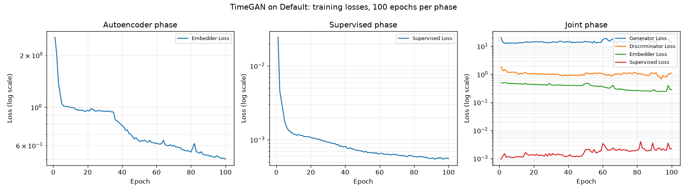

# TimeGAN on Default

TimeGAN (#99) now trains on the Default training split and writes a 10% fill file that the
training grid can score. The rows are valid, but they are much further from the real defaulters
than CTGAN v2's rows: TimeGAN fails 4 hard fidelity checks, CTGAN v2 fails 2. On PR-AUC the two
are level, and neither beats training on the cleaned rows alone. One seed (42) and one fill
level (10%) were run.

Files: `data/interim/default/synthetic/default_timegan_fill10.csv` (same format as the CTGAN
fill files). Code: `src/agentic_gan/tools/timegan.py` (the tool),
`eda/timegan_default/run_timegan_default.py` (the run), `tests/tools/test_timegan.py`.
Every number in this note comes from a file in `eda/timegan_default/artifacts/`; each section
names its file. The step-by-step record is `docs/notes/issue-99-timegan-changelog.md`.

## Result

| | TimeGAN | CTGAN v2 | Reference |
|---|---|---|---|
| Hard fidelity checks failed | 4 of 9 | 2 of 9 | real-vs-real: 0 |
| Mean column distance | 0.355 | 0.087 | limit 0.065 |
| Worst column distance | 0.739 (`PAY_5`) | 0.251 (`PAY_AMT6`) | limit 0.085 |
| Columns over the column limit | 22 of 23 | 9 of 23 | |
| Validation PR-AUC, arm's best model | 0.5254 | 0.5248 | cleaned: 0.5318 |
| Test PR-AUC, same model | 0.5574 | 0.5575 | cleaned: 0.5576 |

Sources: `scorecard.txt`, `quality_fidelity.json`, `pr_auc_comparison.csv`.

## What was built

`tools/timegan.py` is a standard TimeGAN in PyTorch: embedder, recovery, supervisor, generator
and discriminator, each a stack of GRU layers, trained in three phases (autoencoder, supervised,
joint). Its interface mirrors `tools/wgan_gp.py`: `train_timegan`, `sample_timegan`,
`save_model`, `load_model`. The tool takes column names as arguments and learns valid codes,
ranges and dtypes from the training frame, so it holds no Default names.

Sequence layout (`run_meta.json`, `sequence_layout`):

- Each customer is one sequence of 6 steps, oldest month first: suffix 6 (April 2005) to
  suffix 1 (September 2005).
- Each step has 9 features: that month's `PAY_`, `BILL_AMT` and `PAY_AMT` values, then
  `LIMIT_BAL`, `SEX`, `EDUCATION`, `MARRIAGE`, `AGE` and the target `y`.
- The static columns and the target are repeated at every step. After sampling they are read
  back from the first step.
- Every feature is scaled to 0..1. After sampling, coded columns and the target are snapped to
  the nearest value seen in training; the other columns are clipped to the training range and
  rounded.

The fill file is sampled with a filter that keeps rows with `y == 1` that break none of
`DEFAULT_RULES`, and drops any row equal to a training row or to an earlier sampled row.

## Settings and wall time

Source: `run_meta.json`.

| Setting | Value |
|---|---|
| Training rows | 18,000 (3,982 positive, 14,018 negative), `train_cleaned.csv` only |
| Epochs per phase | 100 (140 steps per epoch) |
| Batch size, hidden size, GRU layers | 128, 48, 3 |
| Learning rate, gamma, noise width | 0.001, 1.0, 9 |
| Generator updates per discriminator update | 2 |
| Discriminator updated only when its loss is above | 0.15 |
| Seed, device | 42, CPU (8 torch threads) |
| **Training wall time** | **1,541.6 s (25.7 minutes)** |
| Sampling the fill file | 0.18 s |

The validation and test splits were not read by the run (`run_meta.json`, `data_note`).

## Loss curves

Sources: `loss_curves.png`, `timegan_losses.csv` (one row per phase and epoch).

| Phase | Loss | Epoch 1 | Epoch 100 |
|---|---|---|---|
| Autoencoder | Embedder | 2.5382 | 0.5001 |
| Supervised | Supervised | 0.0244 | 0.0006 |
| Joint | Generator | 20.1341 | 13.7968 |
| Joint | Discriminator | 1.8474 | 1.1029 |
| Joint | Embedder | 0.4990 | 0.2803 |
| Joint | Supervised | 0.0009 | 0.0022 |

The autoencoder and supervised phases learn: both losses fall throughout. The joint phase does
not improve the generator. Its loss is lowest at epoch 4 (12.55), ends at 13.80, and averages
17.37 over the last 10 epochs. The supervised loss rises in the joint phase (0.0009 to 0.0022).
The discriminator loss stays between 0.67 and 1.85, so it neither wins nor collapses.

## Share of defaulters generated

Source: `run_meta.json`, `diagnostic_unfiltered_sample` and `fill_sampler`.

| | Value |
|---|---|
| Real share of `y == 1` in the training split | 22.1% |
| Share of `y == 1` in 5,000 unfiltered TimeGAN rows | 12.4% |
| Rule violation rate in those rows | 0.0000 for all three rules |
| Distinct rows in those rows | 100%, none a copy of a training row |
| Rows drawn to get the 1,004 fill rows | 9,995 in 2 rounds |
| Rows passing the filter (keep rate) | 1,217 (12.2%) |

TimeGAN generates about half the real share of defaulters. The filter makes up for it by
drawing more rows, which costs under a second.

Variety in the unfiltered rows, as distinct values (real, TimeGAN): `SEX` 2, 2; `EDUCATION`
7, 5; `MARRIAGE` 4, 3; `PAY_1` 11, 9; `PAY_5` 10, 10; `PAY_6` 10, 8 (`run_meta.json`,
`distinct_values`).

The fill file passed all nine checks on reread: 1,004 rows, the training columns plus
`is_synthetic`, the training dtypes, every `y` and `is_synthetic` equal to 1, no missing value,
no copy of a training row, no repeated row, no rule broken (`run_meta.json`,
`fill_file_checks`).

## Fidelity scorecard

Sources: `scorecard.txt`, `quality_fidelity.json`. The reference is the 3,982 real positive
training rows. Limits are 2x the real-vs-real distance (`--thresholds suggested`). The gap is
the value minus the limit.

| Hard check | Limit | Real-vs-real | TimeGAN | TimeGAN gap | CTGAN v2 | CTGAN v2 gap |
|---|---|---|---|---|---|---|
| Mean column distance | 0.065 | 0.030 | 0.355 FAIL | +0.290 | 0.087 FAIL | +0.022 |
| Worst column distance | 0.085 | 0.042 | 0.739 FAIL | +0.654 | 0.251 FAIL | +0.166 |
| Spearman difference | 0.055 | 0.025 | 0.347 FAIL | +0.292 | 0.054 | -0.001 |
| Cramer's V difference | 0.050 | 0.025 | 0.311 FAIL | +0.261 | 0.042 | -0.008 |
| Three `DEFAULT_RULES` checks | 0.005 | 0.000 | 0.000 | | 0.000 | |
| Label balance | 0.010 | 0.000 | 0.000 | | 0.000 | |
| Schema match | 0.000 | 0.000 | 0.000 | | 0.000 | |
| Verdict | | PASS | FAIL | | FAIL | |

TimeGAN is over its four limits by 5.5x, 8.7x, 6.3x and 6.2x. CTGAN v2 is over its two by 1.3x
and 3.0x.

Five worst columns of each file (column limit 0.085):

| Rank | TimeGAN | Distance | CTGAN v2 on it | CTGAN v2 | Distance | TimeGAN on it |
|---|---|---|---|---|---|---|
| 1 | `PAY_5` | 0.739 | 0.030 | `PAY_AMT6` | 0.251 | 0.352 |
| 2 | `BILL_AMT6` | 0.559 | 0.084 | `PAY_AMT2` | 0.208 | 0.299 |
| 3 | `PAY_3` | 0.465 | 0.014 | `PAY_AMT5` | 0.200 | 0.397 |
| 4 | `SEX` | 0.426 | 0.026 | `PAY_AMT3` | 0.176 | 0.342 |
| 5 | `PAY_6` | 0.422 | 0.023 | `PAY_AMT1` | 0.160 | 0.308 |

TimeGAN is further from the real rows than CTGAN v2 on every one of the 23 columns. Only
`EDUCATION` (0.045) is under the column limit.

Nothing was retrained or tuned to pass the gate. The issue says the scorecard need not pass.

## Downstream PR-AUC

Source: `pr_auc_comparison.csv`, built from two `training_grid` runs (`--dataset default
--seeds 42 --fill-levels 0.10 --no-save`), one per fill file. Each fill arm trains on 19,004
rows: 18,000 real plus 1,004 synthetic. `*` marks the arm's best model on validation, which is
how `selected` is defined in `agents/training.py`.

| Model | Cleaned val | Cleaned test | CTGAN v2 10% val | CTGAN v2 10% test | TimeGAN 10% val | TimeGAN 10% test |
|---|---|---|---|---|---|---|
| Gradient boosting | 0.5204 | 0.5425 | 0.5176 | 0.5345 | 0.5086 | 0.5186 |
| LightGBM | 0.5244 | 0.5723 | 0.5248 * | 0.5575 * | 0.5229 | 0.5610 |
| CatBoost | 0.5318 * | 0.5576 * | 0.5245 | 0.5553 | 0.5254 * | 0.5574 * |
| Stacking ensemble | 0.1406 | 0.1391 | 0.1407 | 0.1384 | 0.1436 | 0.1416 |

- Neither fill beats cleaned. Against the cleaned arm's best model, TimeGAN's best is 0.0064
  lower on validation and 0.0002 lower on test; CTGAN v2's best is 0.0070 lower on validation
  and 0.0001 lower on test.
- TimeGAN and CTGAN v2 are level: their best models are 0.0006 apart on validation and 0.0001
  on test. With one seed this is a tie, not a ranking.
- Gradient boosting loses the most with TimeGAN rows: 0.0118 on validation and 0.0239 on test
  below cleaned.
- The cleaned rows are identical in the two runs. No synthetic row reached the validation or
  test predictions in either run.
- The stacking ensemble scores about 0.14 in every arm, below the share of positives. It does
  the same in `results/training_all_arms.csv` on `main`, so it is not caused by this work.

The fidelity gate failed badly and PR-AUC barely moved. At a 10% fill the 1,004 synthetic rows
are about 5% of the 19,004 training rows, which may be too few to move a boosted model either
way.

## Limits

- **One seed.** Seed 42 only, for training, sampling and the grid. There is no noise estimate,
  so differences of a few thousandths in PR-AUC cannot be ranked.
- **One fill level.** Only the 10% file exists. The 25% and 50% files were not made or scored.
- **Static columns are modelled as repeated features.** `LIMIT_BAL`, `SEX`, `EDUCATION`,
  `MARRIAGE`, `AGE` and `y` are fed to the network at every step as if they changed monthly,
  and only the first step is kept. The model spends capacity on them six times and nothing
  forces the six copies to agree. This is the fixed design of the issue, not a tuned choice.
- **The arm label.** `training_grid` labels every GAN arm `ctgan`. The TimeGAN run's arm was
  relabelled `timegan_10pct` by hand in `pr_auc_comparison.csv`. In the run's own
  `metrics.csv` it is still `ctgan`.
- **Valid codes are pooled over the six months.** The decoder snaps a repayment status to the
  nearest code seen in any month. A code that is common in one month and rare in the others
  is then a valid target in all of them. This is one cause of the large `PAY_2` to `PAY_6`
  distances in `scorecard.txt`. The counts behind this are in Entry 6 of the changelog; they
  were computed from the fill file and are not in an artifact file.
- **The generator is trained on both classes** and the fill keeps only `y == 1` rows. No
  conditional sampling is used.
- **No tuning.** One setting was run. Epochs, hidden size and learning rate were not searched.

## What #137 needs to wire it in

The tool is ready to call. Selection still treats TimeGAN as not implemented, and these
changes belong to #137:

1. **`tools/selection.py`.** When the temporal test passes, `select_generator` returns
   `timegan` as not trainable with CTGAN as the documented fallback, and logs "TimeGAN is not
   implemented". That branch has to return TimeGAN as trainable. Its scope text says TimeGAN
   covers the monthly block only; this implementation generates the whole row (monthly block,
   static columns and target), so the text needs to change too.
2. **`agents/model_selection.py`.** Add a TimeGAN route beside `_train_wgan_gp`, with the same
   shape: train, save the checkpoint and loss file, sample one pool for the largest fill
   level, and cut each fill file from its first rows. The calls are
   `step_columns_from_wide(DEFAULT_WIDE_TEMPORAL, wide_steps, newest_first=True)`, then
   `train_timegan`, then `sample_timegan` with a filter for the dataset rules and the positive
   class and `drop_duplicates_of` set to the training frame. The run script here shows all of
   it.
3. **The positive-class filter.** Unlike WGAN-GP, which trains on positive rows only, TimeGAN
   trains on both classes. The route must add `y == positive` to the row filter. Only 12.2% of
   draws pass it.
4. **Static column names.** The tool needs the list of static columns. Selection knows the
   monthly columns; the static ones have to come from the dataset config or be derived as
   "every column that is neither monthly nor the target".
5. **torch and LightGBM.** `timegan.py` imports torch at module top. Import it inside the
   route, as `_train_wgan_gp` does, and never train it in a process that has loaded LightGBM.
6. **The arm label.** `ARM_LABELS` in `agents/training.py` maps the GAN arm to `ctgan`. The
   metrics need the generator's name, or TimeGAN results will be reported as CTGAN.
7. **The quality gate and fallback.** This TimeGAN file fails 4 hard fidelity checks. With the
   gate in force the agent will reject it, so #137 has to say what happens next: retry, fall
   back to CTGAN, or accept with a recorded override.
8. **Time.** One training run takes 25.7 minutes on CPU. A retry ladder multiplies that.

## Open

- The decoding fix (valid codes per month instead of pooled) needs no retraining and should
  lower the `PAY_` distances. It changes what "nearest valid value" means in the issue's fixed
  design, so it needs a decision first.
- The generator does not improve in the joint phase. More epochs of the same kind are
  unlikely to help. Not tried: a lower learning rate for the joint phase, a larger hidden
  size, more generator updates per discriminator update, or conditioning on the target.
- Not measured: 25% and 50% fills, more than one seed, and the privacy checks.
